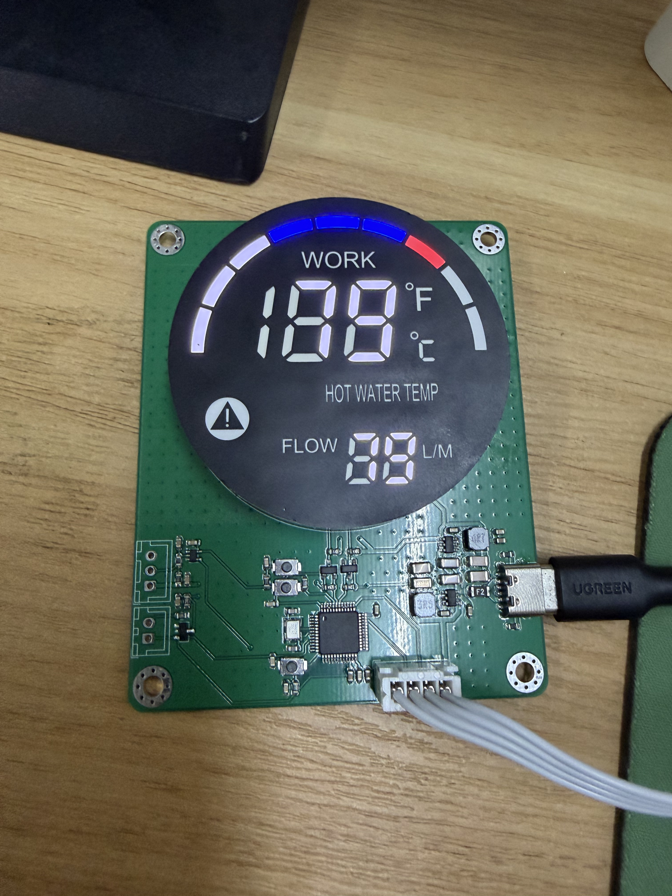
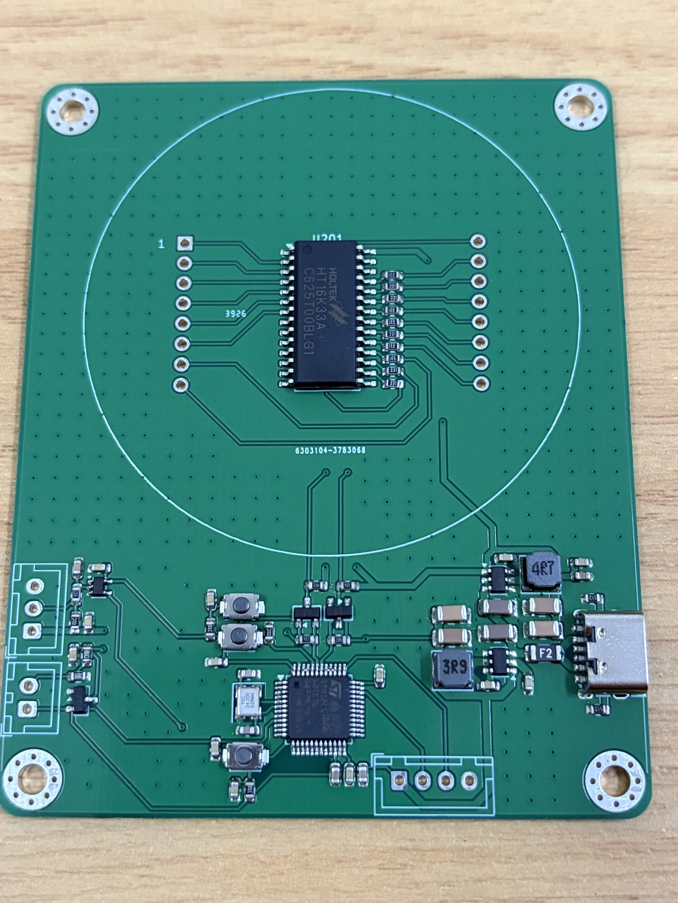
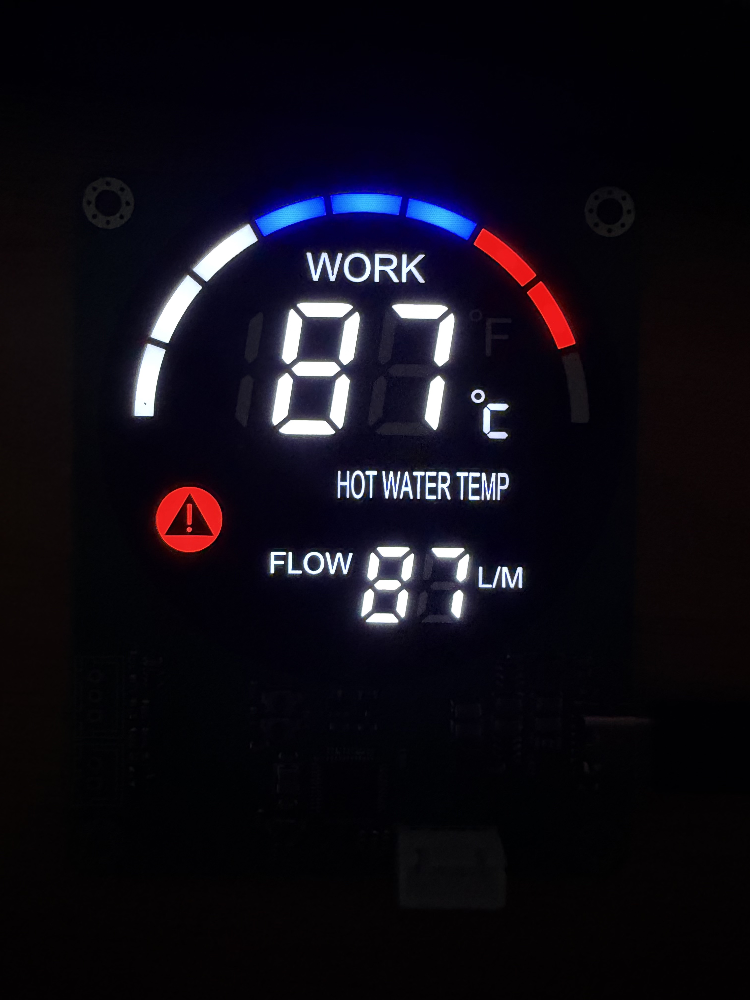
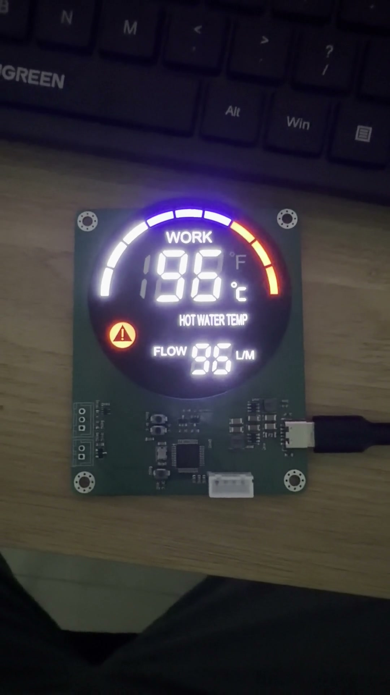

# 项目照片与视频

本目录保存样板外观、早期显示演示和器件规格书预览。
照片与录像可以说明装配和显示外观，不能替代当前产品固件的传感器测量或精度验证。

## 实物照片

| 文件 | 内容 |
| --- | --- |
| [整板点亮](photos/assembled-board-powered.jpg) | 已安装圆屏、USB-C 供电的样板，记录早期显示演示 |
| [PCB 正面](photos/assembled-board-front.jpg) | 未安装圆屏，可见主控、驱动、电源、按键和接口 |
| [暗环境显示](photos/display-lit-dark.jpg) | 数字、图标及环形段的发光效果 |

| 整板点亮 | PCB 正面 | 暗环境显示 |
| --- | --- | --- |
|  |  |  |

## 演示视频

| 文件 | 内容 |
| --- | --- |
| [display-demo.mp4](video/display-demo.mp4) | H.264 兼容版，1080×1920、30fps，时长约 25 秒 |
| [display-demo-original-hevc.mp4](video/display-demo-original-hevc.mp4) | 保存的原始 HEVC 文件，播放能力取决于播放器 |
| [display-demo-poster.jpg](video/display-demo-poster.jpg) | 视频封面 |

视频展示数值往返、环形段变化、提示与告警区域，以及温标切换。
画面数值由早期演示固件生成。

## 规格书预览

| 图片 | 来源 |
| --- | --- |
| [外形尺寸、引脚和矩阵](reference/display-spec-mechanics-and-matrix.png) | 5858-1DRWB-10 规格书 |
| [显示效果与光电参数](reference/display-spec-optical-electrical.png) | 同一规格书 |

原始资料为 [屏幕 PDF](../Documentation/Datasheets/20250303远帆5858-1DRWB-10%281%29.pdf)。
图片便于在线阅读，工程尺寸和参数应核对原始 PDF 与当前库文件。

[项目首页](../README.md) · [硬件参考](../docs/hardware.md) · [验证记录](../docs/validation.md) · [资料授权](../docs/licenses.md)。
