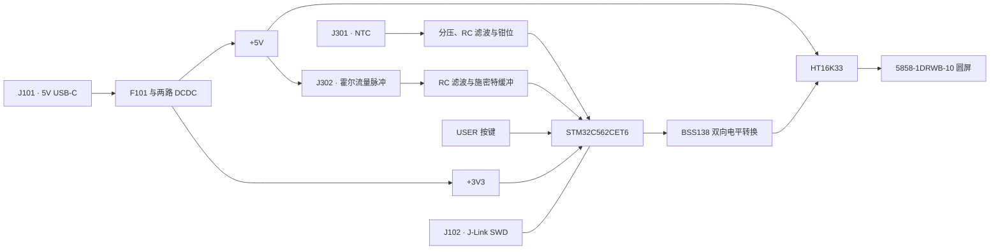

# 系统架构

FluxDial 由电源、传感器调理、STM32 最小系统和 LED 显示四部分组成。
当前产品固件在 MCU 上完成采样、换算与段码生成，没有操作系统、联网服务或上位机应用。

## 硬件数据流

框图表示功能关系，接线应查 [硬件接口表](hardware.md#接口与-mcu-引脚)。
电源轨名称不代表实际负载下的测量结果。

## 原理图分工

| 文件 | 职责 |
| --- | --- |
| [FluxDial.kicad_sch](../Hardware/FluxDial.kicad_sch) | 项目主页与四个层次页入口 |
| [usb_power.kicad_sch](../Hardware/usb_power.kicad_sch) | Type-C 供电、DCDC、BOOT、RESET 与 SWD |
| [mcu_minimum.kicad_sch](../Hardware/mcu_minimum.kicad_sch) | MCU、电源去耦、VCAP、时钟与外设网络 |
| [sensors.kicad_sch](../Hardware/sensors.kicad_sch) | NTC、流量信号调理和 USER 按键 |
| [display.kicad_sch](../Hardware/display.kicad_sch) | I²C 电平转换、HT16K33 和圆屏矩阵 |

## 固件分层

| 层 | 入口 | 职责 |
| --- | --- | --- |
| 启动与调度 | [main.c](../Firmware/Core/Src/main.c)、[system_clock.c](../Firmware/Core/Src/system_clock.c) | 时钟、初始化、周期任务和异常重试 |
| 板级采集 | [board_sensors.c](../Firmware/BSP/Src/board_sensors.c) | ADC、流量中断、周期时间戳和看门狗 |
| 外设驱动 | [board_i2c.c](../Firmware/BSP/Src/board_i2c.c)、[ht16k33.c](../Firmware/BSP/Src/ht16k33.c) | I²C 恢复、命令和帧传输 |
| 数据模型 | [sensor_model.c](../Firmware/App/Src/sensor_model.c) | 阻温表插值、滤波、状态确认和流量换算 |
| 显示逻辑 | [product_display.c](../Firmware/App/Src/product_display.c) | 数字、标签、告警与数值边界处理 |
| 主机测试 | [test_product.c](../Firmware/tests/test_product.c) | 隔离外设后的换算与显示帧测试 |

流量中断更新脉冲和周期数据，主循环在读取时保护共享快照。
温度与流量模型生成 `ProductReadings`，显示层将它转换为 HT16K33 帧。
调试信息通过 [ProductDiagnostics](../Firmware/Core/Inc/product_diagnostics.h) 暴露给 SWD 调试器。

## 状态与边界

应用状态保存在 RAM，没有实现参数持久化或累计流量掉电保存。
屏幕演示录像来自早期演示固件，当前仓库构建入口对应传感器产品固件。
产品固件的采样和异常处理见 [固件参考](firmware.md)，实板验证范围见 [验证记录](validation.md)。
